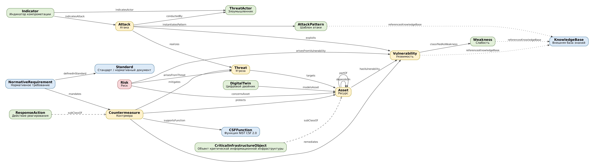

# ISEC — консолидированная онтология информационной безопасности

[](https://doi.org/10.5281/zenodo.23808714)

**Consolidated Information Security Ontology** · версия 1.0.0 · лицензия [CC BY 4.0](LICENSE)

Онтология предметной области информационной безопасности, построенная обобщением опубликованных онтологий (MDISOnt, OntoSecAI, UCO, SEPSES), онтологических моделей цифровых двойников, тезаурусных ресурсов и NIST Cybersecurity Framework 2.0. Предназначена для использования в качестве схемы графа знаний о защищаемой системе в контуре GraphRAG для анализа защищенности.

Онтология описана в статье: Ципорин П.И. *Онтологии информационной безопасности: состояние исследований и консолидированная модель для контура GraphRAG* (в печати).

- Документация: https://andrei56-tech.github.io/isec-ontology/ns/
- Пространство имен: `https://andrei56-tech.github.io/isec-ontology/ns#` (префикс `isec:`)
- IRI версии: `https://andrei56-tech.github.io/isec-ontology/1.0.0/ns`

## Состав

| Показатель | Значение |
|---|---|
| Классы | 17 |
| Объектные свойства | 29 |
| Свойства типов данных | 8 |
| Аннотационные свойства | 2 (`isec:sourcedFrom`, `isec:designDecision`) |
| Именованные индивиды | 13 (6 функций NIST CSF 2.0, 5 внешних баз знаний, 2 стандарта) |
| Триплеты | 445 |

Аксиоматика ограничена профилем OWL 2 RL. Для каждой конструкции аннотация `isec:sourcedFrom` указывает источник обобщения, а `isec:designDecision` — обоснование решения там, где источники расходятся (соотношение угрозы и атаки, статус риска, статус цифрового двойника).



## Структура репозитория

| Путь | Содержимое |
|---|---|
| `ontology/isec_ontology.ttl` | онтология (RDF 1.1 Turtle, OWL 2) — основной файл |
| `ontology/isec_ontology.owl`, `.jsonld` | та же онтология в RDF/XML и JSON-LD |
| `examples/example_system.ttl` | иллюстративный набор данных: АСУ ТП подстанции с цифровым двойником |
| `examples/example_corporate_ics.ttl` | иллюстративный набор данных: корпоративный сегмент и сегмент АСУ ТП, две цепочки атаки, непокрытые функции Respond и Recover |
| `queries/*.rq` | запросы SPARQL: цепочки атак, непокрытые функции CSF, риски ресурса |
| `scripts/validate.py` | проверка синтаксиса, меток, непротиворечивости и выполнение запросов |
| `docs/` | документация для GitHub Pages; по IRI терминов открывается их описание |

## Проверка

```bash
pip install -r requirements.txt
python scripts/validate.py
```

Скрипт проверяет состав модели, наличие русских и английских меток, области определения и значений свойств, выполняет замыкание OWL-RL (онтология отдельно и вместе с примером данных) и проверяет, что экземпляры `owl:Nothing` не выводятся, а затем выполняет запросы из `queries/` на примере данных.

## Использование

RDF-хранилища (Apache Jena Fuseki, GraphDB, Virtuoso и др.) загружают `isec_ontology.ttl` напрямую. Для СУБД графов свойств (Neo4j) используется импорт RDF, например плагин neosemantics (n10s): классы становятся метками узлов, объектные свойства — типами ребер.

Онтология задает только схему. Сведения о конкретной системе (ресурсы, конфигурации, уязвимости, контрмеры) добавляются отдельным графом данных по образцу `examples/example_system.ttl`.

## Цитирование

Ципорин П.И. ISEC: консолидированная онтология информационной безопасности. Версия 1.0.0. 2026. URL: https://github.com/Andrei56-tech/isec-ontology. DOI: 10.5281/zenodo.23808714.

Метаданные для цитирования — в файле [CITATION.cff](CITATION.cff).

## Источники

1. Gacitua R., Diéguez-Rebolledo M. Toward a Unified View of Cybersecurity Ontologies: A Systematic Review and Conceptual Consolidation // Applied Sciences. 2026. Vol. 16, no. 12. Art. 6185. DOI: 10.3390/app16126185.
2. Meriah I., Ben Arfa Rabai L., Khedri R. Building a comprehensive and multi-dimensional information security ontology: elicitation process and OWL implementation // Knowledge and Information Systems. 2025. Vol. 67, no. 1. P. 167–195. DOI: 10.1007/s10115-024-02308-y.
3. Ullah U., Haleem M., Ullah A. OntoSecAI: Ontology-driven security automation for AI-enabled systems // PLoS One. 2025. Vol. 20, no. 12. Art. e0337806. DOI: 10.1371/journal.pone.0337806.
4. Syed Z., Padia A., Mathews M., Finin T., Joshi A. UCO: A Unified Cybersecurity Ontology // Proc. AAAI Workshop on Artificial Intelligence for Cyber Security. 2016. P. 195–202.
5. Kiesling E., Ekelhart A., Kurniawan K., Ekaputra F.J. The SEPSES Knowledge Graph: An Integrated Resource for Cybersecurity // ISWC 2019. LNCS. Vol. 11779. P. 198–214. DOI: 10.1007/978-3-030-30796-7_13.
6. Массель Л.В., Ворожцова Т.Н. Онтологический подход к построению цифровых двойников объектов и систем энергетики // Онтология проектирования. 2020. Т. 10, № 3. С. 327–337. DOI: 10.18287/2223-9537-2020-10-3-327-337.
7. Лукашевич Н.В., Добров Б.В., Павлов А.М., Штернов С.В. Онтологические ресурсы и информационно-аналитическая система в предметной области «Безопасность» // Онтология проектирования. 2018. Т. 8, № 1. С. 74–95. DOI: 10.18287/2223-9537-2018-8-1-74-95.
8. The NIST Cybersecurity Framework (CSF) 2.0. NIST CSWP 29. 2024. DOI: 10.6028/NIST.CSWP.29.
9. ISO/IEC 27000:2018. Information security management systems — Overview and vocabulary.

---

### English summary

ISEC is a domain ontology of information security consolidated from published security ontologies and frameworks. It serves as the schema of a knowledge graph of a protected system in a GraphRAG pipeline for security posture analysis. The ontology (RDF 1.1 Turtle, OWL 2 RL) contains 17 classes, 29 object properties, 8 datatype properties and 13 named individuals; every construct is annotated with its source. Labels are provided in Russian and English. Run `python scripts/validate.py` to check the ontology and the example data. License: CC BY 4.0.
